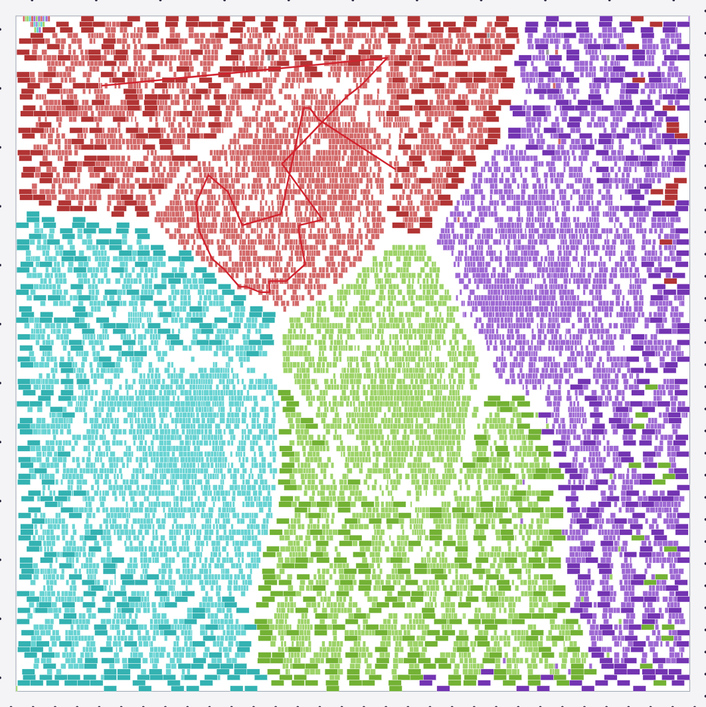

# chipflow

An open digital EDA flow, written to be read and extended: Verilog goes in, and a
verified, placed, timed and globally routed layout on the Nangate45 open cell library comes
out. The two built-in benchmarks are the building blocks of AI accelerators: a TPU-style
systolic array and a GPU-style SIMT core slice.

```
Verilog ─► lint + synthesis ─► gate-level simulation ─► floorplan ─► global placement ─► legalization
           (Yosys → Nangate45)  vs golden model           (ePlace-style, PyTorch)   (gap-filling)
       ─► static timing ─► global routing ─► post-route timing + power ─► DEF, SVG layout, report.json
          (Liberty NLDM)   (PathFinder A*)    (activity from simulation)
```

| Stage | Front end / back end | What it does | Code |
|---|---|---|---|
| Synthesis | front | Yosys (YoWASP build, pip-installable) maps RTL onto Nangate45 cells; lint warnings are reported | `synth.py` |
| Verification | front | Bit-parallel gate-level simulator: 64 independent test vectors per pass, cell behavior compiled from the Liberty `function` strings, compared with a Python golden model | `sim.py`, `designs.py` |
| Floorplan + placement | back | Core sized for a target utilization; global placement minimizes weighted-average wirelength plus an electrostatic density energy (FFT Poisson solve); a gap-filling legalizer snaps cells to rows and sites | `place.py` |
| Static timing | back | Rise/fall propagation with unateness through Liberty NLDM delay and slew tables; Elmore wire delay from placed or routed lengths; setup checks at flip-flops; critical path trace | `sta.py` |
| Global routing | back | Gcell grid with track capacities from metal2–6 pitches; MST net decomposition; L-shape initial routes; negotiated rip-up and reroute (PathFinder) with A* | `route.py` |
| Power | back | Switching power from simulated toggle rates on routed net capacitance, clock power, Liberty leakage | `power.py` |
| Outputs | back | DEF (opens in KLayout or OpenROAD), layout and congestion SVGs, JSON report | `layout.py` |

## Demo

[**chipflow layout explorer**](https://aabhimittal.github.io/chipflow/) is a static page in `demo/`
built from a real run of both designs. It opens with a short guide (how to use it, how to read it,
things to try), then:
- **Layout:** the placed chip. Hover any cell to see its block, cell type and critical-path stage;
  color by block or by flip-flop vs. logic; overlay the critical path, routing congestion and I/O pins.
- **Critical path:** a gate-by-gate table that highlights each gate on the layout.
- **Slack histogram:** the timing margin at every endpoint.
- **Flow stages and source:** what each of the 7 stages produced, and the Verilog source.

```bash
python demo/build_data.py                  # rerun both designs, write demo/data.json (~35 s)
python -m http.server -d demo 8000         # open http://localhost:8000
```

`.github/workflows/pages.yml` deploys it on pushes to `main` that touch `demo/`. Enable it once
under *Settings → Pages → Source: GitHub Actions*.

## Quickstart

```bash
pip install --index-url https://download.pytorch.org/whl/cpu torch
pip install -e ".[test]"
python -m chipflow fetch-pdk          # Nangate45 from OpenROAD-flow-scripts, checksum-pinned
pytest -q                            # ~15 s

python -m chipflow flow --design systolic --param N=4 --clock-ns 2.0 --out runs/sa4
python -m chipflow flow --design simt --clock-ns 3.0 --out runs/simt
python -m chipflow flow --verilog my.v --top my_top --clock-ns 2.0 --out runs/mine   # your own RTL
```

## Results (CPU, 4 cores, defaults)

| | 4×4 systolic array (INT8 MAC, 24-bit acc) | SIMT slice (4 lanes, 2 warps, 16-bit) |
|---|---|---|
| Cells / flip-flops | 12,736 / 640 | 11,094 / 1,088 |
| Cell area | 16,573 µm² | 17,181 µm² |
| Gate-level verification | 1,024 outputs, 0 mismatches | 50,944 lane outputs, 0 mismatches |
| Core (60% utilization) | 166 × 167 µm | 169 × 169 µm |
| Placed HPWL / routed wirelength | 111 mm / 125 mm | 103 mm / 161 mm |
| Routing overflow | 0 | 10 (register-file muxes; see limits) |
| fmax placed → routed | 567 → 564 MHz | 453 → 425 MHz |
| Critical path | 28 stages, register → signed multiplier → adder → accumulator | 28 stages, register file read → multiply-add |
| Power at the target clock | 4.11 mW | 4.35 mW |
| Runtime, whole flow | 9 s | 21 s |

<p>


</p>

Left: the 16 processing elements of the systolic array land as 16 tiles. Right: the SIMT
slice splits into its 4 lanes, with each lane's register-file flip-flops (darker) inside it.
Red is the post-route critical path.

## Things the flow already caught

- **A signed-arithmetic RTL bug.** The first systolic PE wrote
  `acc <= clr ? {ACC{1'b0}} : acc + a_in * b_in`. In Verilog, the unsigned concatenation makes
  the whole `?:` expression unsigned, which silently zero-extends the signed operands: −1 × 5
  came out as 1275. Gate-level simulation against the golden model failed on 234 of 256
  outputs; the fix was an `if/else`.
- **A legalizer that could not backfill.** Tetris-style append-only rows failed on the SIMT
  core at 60% utilization, because a dense cluster near one edge exhausted the rows to its
  right. The legalizer now keeps each row's free intervals and fills the nearest gap.
- **A placement schedule that quit too early.** Growing the density weight 5% per iteration
  spread cells before wirelength could organize them. 2% per iteration cut systolic HPWL by
  31% and more than doubled the post-placement slack.

## Limits

- **Not signoff.** Nangate45 is purposely non-manufacturable; there is no DRC, LVS or
  parasitic extraction, and timing uses one typical corner.
- **Global routing only.** No track assignment or detailed routing. The SIMT core ends with
  10 overflowed gcell edges: its 16:1 register-file read muxes need more tracks than 60%
  utilization leaves; a lower `--util` or more router iterations clears it.
- **Ideal clock.** No clock-tree synthesis, so no skew and no hold analysis.
- **No timing repair yet.** No gate sizing or buffering; high-fanout nets (clock, clear) are
  excluded from placement wirelength.
- **Power is a lower bound.** Cell internal power (Liberty `internal_power` tables) is not
  modeled.
- **Single-threaded Python** for the router, STA and legalizer; placement uses PyTorch on CPU.

## Roadmap

1. Timing-driven placement: make the STA differentiable and feed slack gradients to placement.
2. Gate sizing and buffering against the Liberty drive strengths (X1/X2/X4).
3. Clock-tree synthesis and hold analysis.
4. Track assignment, then detailed routing.
5. GPU kernels for placement density, STA propagation and routing cost updates, for designs
   above 100k cells.

## License

Apache-2.0. Nangate45 is downloaded at setup from OpenROAD-flow-scripts under its own
Apache-2.0 terms and is not redistributed here.
