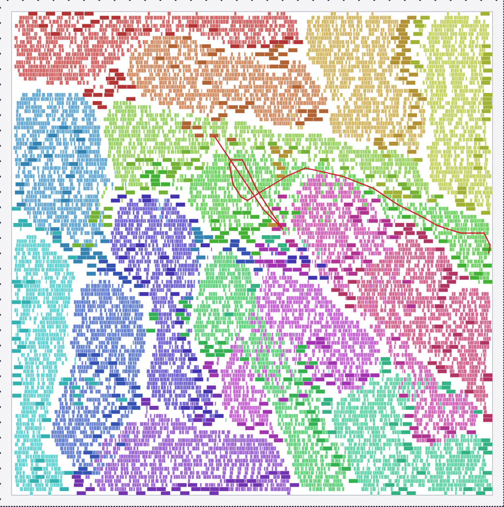

# chipflow

An open digital EDA flow, written to be read and extended: Verilog goes in, and a
verified, placed, timed and globally routed layout on the Nangate45 open cell library comes
out. The two built-in benchmarks are the building blocks of AI accelerators: a TPU-style
systolic array and a GPU-style SIMT core slice.

```
Verilog ─► lint + synthesis ─► gate-level simulation ─► floorplan ─► global placement ─► legalization
           (Yosys → Nangate45)  vs golden model           (ePlace-style, PyTorch)   (gap-filling)
       ─► clock tree + buffering ─► sizing + hold fix ─► global routing ─► post-route timing + power ─► DEF, SVG, report.json
          (CTS, design-rule repair)  (propagated-clock STA) (PathFinder A*)   (re-verified netlist activity)
```

| Stage | Front end / back end | What it does | Code |
|---|---|---|---|
| Synthesis | front | Yosys (YoWASP build, pip-installable) maps RTL onto Nangate45 cells; lint warnings are reported | `synth.py` |
| Verification | front | Bit-parallel gate-level simulator: 64 independent test vectors per pass, cell behavior compiled from the Liberty `function` strings, compared with a Python golden model | `sim.py`, `designs.py` |
| Floorplan + placement | back | Core sized for a target utilization; global placement minimizes weighted-average wirelength plus an electrostatic density energy (FFT Poisson solve); a gap-filling legalizer snaps cells to rows and sites. **Timing-driven**: near-critical nets are weighted and the design re-placed. **Routability-driven**: cells in congested gcells are inflated and re-placed until routing overflow clears | `place.py` |
| Static timing | back | Rise/fall propagation with unateness through Liberty NLDM delay and slew tables; Elmore wire delay from placed or routed lengths; propagated clock through the clock tree (latency and skew per flip-flop); setup on latest arrivals, hold on earliest; slew and capacitance limit checks; backward required-time pass for slack on every net; critical path trace. **Path tags**: arrivals are kept per (launch clock, `-from` matches, `-through` crossings), so exceptions are exact per path. **Several clocks**: launch/capture use the most restrictive edge pair over the clocks' common period, hold derives from it, as SDC defines. **Levelized engine**: cells are grouped by logic level and each level is a few numpy operations (all NLDM lookups of the level at once, max per net with the reference engine's tie order); bit-identical to the per-arc Python engine, which stays as the reference and for `-through` exceptions | `sta.py`, `sta_vec.py` |
| Constraints (SDC) | back | Reads the everyday SDC subset: `create_clock` (several, with `-waveform`), per-port `set_input_delay` / `set_output_delay` (`-clock`, `-max` / `-min`), `set_driving_cell`, `set_load`, `set_false_path` and `set_multicycle_path` with any of `-from` / `-through` / `-to` (multicycle with SDC's hold-edge rule), `set_clock_groups`, `set_clock_uncertainty`, `set` / `expr`, and `get_ports` / `get_cells` / `get_nets` / `get_clocks` / `all_*` queries. `get_cells` matches flip-flops by their RTL register name (`row[0].col[1].pe.acc[3]`). Unsupported commands are errors, not silently dropped. Without a file, the default is a budget: inputs arrive at `io-budget` × period through a `BUF_X4`, outputs must be ready as early into 4 fF. Port paths are timed for setup and hold and port nets are buffered like internal ones | `sdc.py`, `sta.py` |
| Clock tree + buffers | back | Clock-tree synthesis: each clock's flip-flops are split by recursive median bisection into groups of ≤ 16 under a `CLKBUF_X3`, level by level up to the clock pin. Design-rule repair: nets driving > 16 pins get a `BUF_X4` tree, then drivers still over the slew or capacitance limit are upsized. Hold fixing: `BUF_X1` delay cells in front of flip-flops whose data arrives too early, where setup slack allows. **Useful skew** (when setup fails, before sizing): `CLKBUF_X1` chains on the clock pins of flip-flops capturing near-critical paths, worth half the gap between their capture and launch slack; a round is kept only if WNS improves with no new hold failures, and it stops once setup is met. **Setup repair picks its strategy by outcome**: gate sizing alone and useful skew + sizing both run from the same snapshot; each candidate runs the whole rest of the back end (hold repair, routing with congestion re-placement, post-route repair, power) and the better final WNS wins, then the lower power, then area; the winner's finished state is kept, not recomputed | `buffer.py`, `size.py` |
| Timing repair | back | Gate sizing: worst-slack cells move up the library's drive strengths (X1 → X2 → X4…) in batches kept only if WNS improves; runs after buffering and again on routed lengths | `size.py` |
| Detailed routing | back | `--detail`: **track assignment** puts each straight run of 2+ gcells of a global route on a layer and track of its panel (left-edge packing, long runs on metal5/6); a compiled maze router then grows each net's tree on the metal2–6 track grid inside its global route, preferring its assigned tracks, and negotiates shared nodes away (PathFinder) until there are no shorts. Checked for shorts, opens and off-track wires; wires and vias are written to the DEF | `detail.py`, `layout.py` |
| Global routing | back | Gcell grid with track capacities from metal2–6 pitches; MST net decomposition; L-shape initial routes; negotiated rip-up and reroute (PathFinder) with A*. Pattern routing and A* run as numba kernels (routes identical to the earlier Python router) | `route.py` |
| Power | back | Switching power from simulated toggle rates on routed net capacitance, clock-tree power (every clock net switches twice a cycle), Liberty leakage | `power.py` |
| Outputs | back | DEF (opens in KLayout or OpenROAD), layout and congestion SVGs, JSON report | `layout.py` |

## Demo

[**chipflow layout explorer**](https://aabhimittal.github.io/chipflow/) is a static page in `demo/`
built from a real run of both designs. It opens with a short guide (how to use it, how to read it,
things to try), then:
- **Layout:** the placed chip. Hover any cell to see its block, cell type and critical-path stage;
  color by block or by flip-flop vs. logic; overlay the critical path, routing congestion and I/O pins.
- **Critical path:** a gate-by-gate table that highlights each gate on the layout.
- **Slack histogram:** the timing margin at every endpoint.
- **Flow stages and source:** what each of the 7 stages produced, and the Verilog source.

```bash
python demo/build_data.py                  # rerun both designs, write demo/data.json (~35 s)
python -m http.server -d demo 8000         # open http://localhost:8000
```

`.github/workflows/pages.yml` deploys it on pushes to `main` that touch `demo/`. Enable it once
under *Settings → Pages → Source: GitHub Actions*.

## Quickstart

```bash
pip install --index-url https://download.pytorch.org/whl/cpu torch
pip install -e ".[test]"
python -m chipflow fetch-pdk          # Nangate45 from OpenROAD-flow-scripts, checksum-pinned
pytest -q                            # ~15 s

python -m chipflow flow --design systolic --param N=4 --clock-ns 2.0 --out runs/sa4
python -m chipflow flow --design simt --clock-ns 3.0 --out runs/simt
python -m chipflow flow --verilog my.v --top my_top --clock-ns 2.0 --out runs/mine   # your own RTL
python -m chipflow flow --design systolic --sdc designs/systolic_array.sdc --out runs/sa4_sdc  # constraints file
```

[`designs/systolic_array.sdc`](designs/systolic_array.sdc) is a worked example: the same 30% budget written
as SDC, plus 50 ps of clock uncertainty and a two-cycle multicycle path on the accumulator pins. It
times at 625 MHz instead of 645: the uncertainty alone, as 1.549 + 0.050 ns = 1.599 ns.

## Results (CPU, 4 cores, defaults)

| | 4×4 systolic array (INT8 MAC, 24-bit acc) | SIMT slice (4 lanes, 2 warps, 16-bit) |
|---|---|---|
| Cells / flip-flops (with input registers) | 12,800 / 704 | 11,065 / 1,110 |
| Cell area | 16,862 µm² | 17,235 µm² |
| Gate-level verification, before and after back-end edits | 1,024 outputs, 0 mismatches | 50,688 lane outputs, 0 mismatches |
| Core (60% utilization) | 166 × 167 µm | 169 × 169 µm |
| I/O budget | 30% of the cycle each side, `BUF_X4` input drivers | same |
| Clock tree | 68 `CLKBUF_X3`, **skew 19 ps** | 136 `CLKBUF_X3`, **skew 27 ps** |
| Design-rule repair | 97 nets buffered (208 `BUF_X4`); slew/cap violations 17/65 → **0/0** | 235 nets buffered (814 `BUF_X4`, including the instruction ports), 67 drivers upsized; 614/234 → **0/0** |
| Routed fmax at 2.0 / 3.0 ns | **645 MHz** | **503 MHz** |
| Hold, worst slack | +0.133 ns, no delay buffers needed | +0.115 ns, none needed |
| Tightest clock met after routing | **1.2 ns (834 MHz)**: useful skew (1,020 clock buffers) + 432 cells upsized. Sizing alone: 1.4 ns (715 MHz) | **1.9 ns (528 MHz)**; misses 1.8 ns by 2 ps |
| Setup repair the flow keeps at 1.4 / 1.9 ns (judged on the finished back end) | sizing: 6.11 mW (the routed estimate equals the final power) instead of useful skew at 6.21 mW | sizing: 254 upsized, 7.75 mW, instead of skew + sizing at 8.95 mW |
| Critical path | 29 stages, register → signed multiplier → adder → accumulator | 33 stages, issue register → buffer trees → decode → register-file read → ALU |
| Power at the target clock | 4.18 mW | 5.00 mW |
| Runtime, whole flow | 11 s | 29 s |
| Detailed routing (`--detail`) | 13,078 nets on metal2–6: **0 shorts, 0 opens**, 139.7 mm, 112k vias; flow 49 s | 12,038 nets: **0 shorts, 0 opens**, 201.5 mm, 128k vias; flow 131 s |

Before I/O constraints the ports were ideal (arrival 0, infinite drive), which reported 651 / 587 MHz.
The systolic array loses only 1% once its inputs are registered. SIMT's 587 MHz relied on
instructions reaching ~600 loads instantly; driven by a real cell through a registered issue stage
it runs at 503 MHz.

Timing-driven placement was checked against a control: an unweighted second placement pass
alone gains +1.2% (systolic) and +0.4% (SIMT) fmax; the net weights add about +3.5% and +2.9% on top.

<p>


</p>

Left: the 16 processing elements of the systolic array land as 16 tiles. Right: the SIMT
slice splits into its 4 lanes, with each lane's register-file flip-flops (darker) inside it.
Red is the post-route critical path.

## Things the flow already caught

- **A signed-arithmetic RTL bug.** The first systolic PE wrote
  `acc <= clr ? {ACC{1'b0}} : acc + a_in * b_in`. In Verilog, the unsigned concatenation makes
  the whole `?:` expression unsigned, which silently zero-extends the signed operands: −1 × 5
  came out as 1275. Gate-level simulation against the golden model failed on 234 of 256
  outputs; the fix was an `if/else`.
- **A legalizer that could not backfill.** Tetris-style append-only rows failed on the SIMT
  core at 60% utilization, because a dense cluster near one edge exhausted the rows to its
  right. The legalizer now keeps each row's free intervals and fills the nearest gap.
- **Constraints exposed a design problem, not a flow problem.** With a 30% I/O budget, both critical
  paths started at an input port: the systolic operands feed the multipliers directly, and SIMT's
  instruction port drove decode, register read and the ALU in one cycle (fmax fell to 508 / 376 MHz).
  The fix was RTL: a `REG_IN` parameter registers the inputs at the block edge. Duplicating SIMT's issue
  register per lane in RTL did nothing, because Yosys merges identical flip-flops (`opt_merge`, and
  `keep` on the register does not stop it); cloning it in the back end instead gained under 1%, so
  that code was not kept.
- **Hold needed a real fix only with unrealistic inputs.** With a zero input delay, inputs arrive at
  time 0 while the clock tree delivers the edge ~130 ps later: 84 hold violations on the systolic
  array. Chained delay buffers with a 10 ps margin, before and after routing, close it.
- **Buffering mattered more than sizing.** The systolic array's 8-bit operands fan out to 31
  partial-product gates each from a single `AND2_X1`, and SIMT's register-file decoders drive up
  to 66 pins. Buffering those nets (and upsizing weak drivers) cleared every slew and capacitance
  violation and raised routed fmax 10% (systolic) and 33% (SIMT), more than sizing alone did.
- **Routing that could not converge.** SIMT kept 10 overflowed edges however long the router
  negotiated: 15 connections needed an edge with 14 tracks and every detour was full, so the
  congestion just moved around. The fix belonged in placement: inflate cells in hot gcells and
  re-place, which cleared it in one round.
- **Python's `sum()` is not a plain loop.** The vectorized timer first disagreed with the reference
  in the last bit (1e-16 ns) on 17 hold slacks and 46 net slacks. The cause: since Python 3.12,
  `sum()` over floats is compensated (Neumaier), while numpy adds plainly. Summing pin capacitance
  with Python's `sum` per net made the engines bit-identical; a tolerance would have hidden it.
- **Slack gradients in placement matched net weights, no more.** A smooth worst slack (log-sum-exp
  arrivals over the near-critical levelized graph, wire and load-dependent gate delays from the
  NLDM tables) was differentiated with respect to every cell position and added to global
  placement. On the 4×4 array it reached 581 MHz (placed) at the wirelength of the net weights'
  590, and 593 only by spending 2.4% more wire, which stronger weights also do; on SIMT, 160 vs.
  163 MHz. It took 3× the placement time and refreshing the gradient every iteration (refreshing
  every 10 let Adam's momentum push stale directions). Not kept; net weights remain.
- **A profiler that pointed at the wrong stage.** cProfile put the timer at 52% of the 8×8 run and
  the NLDM lookup as its hot spot; inlining the lookup (1.4×) and reusing forward delays in the
  backward pass cut profiled time 22%, but the unprofiled run moved 5%. Profiling taxes every
  Python call, so call-heavy code looks worse than it is; per-stage wall-clock timing showed the
  real split (above) and is what the roadmap now follows.
- **Incremental timing that was correct but not shown to pay.** A `Timer` that re-evaluates only
  cells whose inputs changed after a resize matched full analysis bit for bit on randomized
  resizes (including flip-flops, whose clock-pin load moves clock latencies), was 2.5× faster
  per update in-process, and later sizing rounds touched only 4-24% of the design. But a
  sizing-heavy flow (4×4 at 1.4 ns, sizing only) took the same time end to end (20.2 vs 20.8 s):
  each round still recomputes required times and endpoints over the whole design, and sizing
  converges in ~9 rounds. The code was removed. Correction: the isolated sizing timings first
  quoted here (4×4: 6.3 vs 5.9 s; 8×8: 21.1 vs 21.7 s) compared the branch with itself, because a
  script run from another checkout imported the installed (branch) package; only `python -m` runs
  from each checkout, or `PYTHONPATH`, compare two versions. The 8×8 case was never measured.
- **Track assignment earned its place.** On the 4×4 array, detailed routing with assigned tracks
  took 42 s against 52 s without, and moved 37.6 mm of wire to metal5/6 (10.9 mm without),
  leaving metal2/3 for pin access, for 1.2% more total wire.
- **An area that was read after the undo.** The lookahead's judge reported each candidate's area
  after putting the netlist back, so post-route sizing was missing from it; an assertion that the
  adopted state's area equals the judged one failed on SIMT 1.8 ns and pointed straight at it.
- **A benchmark that compared a branch with itself.** That import mistake was caught when the
  compiled router's paths differed from "main" in an impossible way (vertical edges side by side
  in one row): both runs had loaded the new router. With `PYTHONPATH` set, every path matched.
- **Useful skew that overshot.** Rounds kept adding clock buffers after setup was already met:
  SIMT at 1.9 ns needed 89 ps and got 138 ps, for 1,212 buffers. Stopping at WNS ≥ 0, as sizing
  does, cut that to 858 and systolic at 1.4 ns from 984 to 450.
- **A placement schedule that quit too early.** Growing the density weight 5% per iteration
  spread cells before wirelength could organize them. 2% per iteration cut systolic HPWL by
  31% and more than doubled the post-placement slack.

## Limits

- **Not signoff.** Nangate45 is purposely non-manufacturable; there is no DRC, LVS or
  parasitic extraction, and timing uses one typical corner.
- **Detailed routing is an on-grid model, and opt-in.** Wires sit on a 0.19 × 0.14 µm grid in each
  layer's preferred direction (metal4–6 on every second line, so their 0.14 µm spacing holds;
  that leaves about a quarter of metal4/6 tracks unused). Checked: shorts, opens, wires off
  their tracks. Not checked: via-to-via cut spacing (neighbouring grid points can put two cuts
  0.07 µm apart against a 0.08 µm rule), minimum area, end-of-line rules. Pins are their center
  point, reached by a via1 to the nearest free metal2 node; tie-cell nets (one `LOGIC0/1` per
  design) are not routed. Timing still uses global-route lengths, not extracted detailed wires.
  It takes about 4× the rest of the flow, so it is off unless `--detail` is given.
- **Clock tree is geometric, not skew-balanced, on purpose.** Median bisection leaves
  19 / 27 ps of skew. Measured on the routed critical paths, the capturing flip-flop's clock arrives
  6.7 / 10.3 ps *after* the launching one's: skew is lending the slowest path time. A zero-skew tree
  would cost ~0.5% fmax, and even fully adverse skew is 1.2–1.4% of the path, with hold margin
  above 100 ps. Skew does grow with the die: an 8×8 array (51k cells, 2,688 flip-flops, 272 clock
  buffers) has 68 ps, but its critical path still sees +1.2 ps. Since zero skew shifts every
  path's slack by −(capture − launch), it cannot raise WNS above the current critical path's
  slack minus that term: balancing can only lose here. Useful skew, the opposite of balancing,
  is built; it helps where critical paths feed slacker ones (systolic: +17% tightest clock) and
  barely where pipeline stages are balanced (SIMT: under 1%, at 15% more power). The flow runs
  both repairs through the rest of the back end and keeps the better, so each design gets the
  right one without a switch. Judging on one routing pass was not enough: at SIMT's 1.8 ns it
  favored sizing (−76 vs −108 ps), which then finished at −35 ps after congestion re-placement and
  post-route sizing; judged on the finished back end, useful skew is kept and finishes at −2 ps.
  Neither closes 1.8 ns.
- **SDC subset.** One `-through` per exception (an ordered sequence is rejected); overlapping
  exceptions resolve by definition order, not SDC's specificity rules; no generated or virtual
  clocks, and only rising-edge flip-flops. `get_ports` takes whole buses (`a_west`, not
  `a_west[3]`). With `--no-io`, ports are ideal and only register-to-register paths are hold-checked.
- **Hold fixing uses buffer chains.** Nangate45 has no delay cells, so hold repair chains `BUF_X1`s:
  with a zero input delay (`--io-budget 0`) the systolic array needs ~700 of them, costing 1% fmax.
- **Power is a lower bound.** Cell internal power is not modeled. Nangate45 does not declare the
  unit of its `internal_power` tables, and the two Liberty readings (V²·fF = fJ, or V·mA·ns = pJ)
  differ 1000×; neither matches a 45 nm gate cleanly, so this waits for a calibration against a
  reference tool.
- **Python legalizer**; placement uses PyTorch on CPU, timing numpy, and the router's A* and
  pattern routing are numba kernels. The levelized timer made one 8×8 timing run 2.7× faster
  (4.3 → 1.6 s); the compiled router routes the congested 8×8 first pass 13× faster (224 →
  17 s) with identical paths. Flows: 8×8 52.5 → 40.0 s, SIMT 36.1 → 29.0 s over the previous
  release.

## Roadmap

1. Detailed-routing checks beyond shorts and opens: via cut spacing, minimum area, pin shapes.
2. Timing from the detailed wires (per-layer RC instead of one wire model on global lengths).
3. GPU kernels for placement density, STA propagation and routing cost updates, for designs
   above 100k cells.

## License

Apache-2.0. Nangate45 is downloaded at setup from OpenROAD-flow-scripts under its own
Apache-2.0 terms and is not redistributed here.
